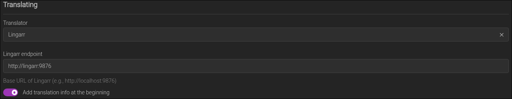
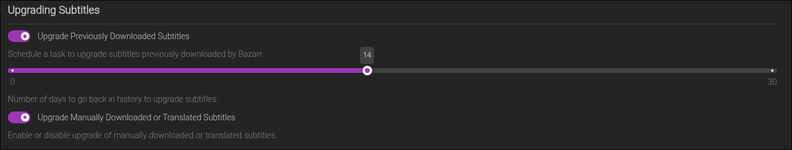

# Bazarr Subtitle Translation Automation Script

A Python script that automates subtitle translation in Bazarr by leveraging its API. The script identifies missing subtitles for movies and series, checks if existing subtitles can be translated into the missing language, and queues translation requests automatically.

> ⚠️ **Critical Warning**
>
> This script can trigger **a high volume of subtitle translations** automatically depending on the settings.  
> If your Bazarr instance is linked to a **paid translation service**, this could lead to **unexpected charges**.
>
> The following limits exist to mitigate this:
>
> - `MAX_RETRIES` (default: 3): a failing translation is skipped after this many failed attempts
> - `MAX_TRANSLATIONS_PER_SCAN` (default: 0, unlimited): caps how many translation requests are queued per scan cycle (series and movies combined)
> - `TRANSLATION_DELAY_SECONDS` (default: 0, disabled): minimum wait between two translation requests, a simple rate limiter
> - `DRY_RUN` (default: `false`): log the translations that would be requested without sending anything to Bazarr
>
> Rate limiting is only active if `TRANSLATION_DELAY_SECONDS` is set, so configure the limits and monitor your usage.

---

## Features

- Automatically scans movies and series for missing subtitles.
- Checks if existing subtitles can be translated into the missing language.
- Queues translation requests using Bazarr API.
- Translates the regular, forced and hearing-impaired variants of a language as separate requests, with the correct target flags sent to Bazarr.
- Optional delay between translation requests (rate limiting).
- Dry-run mode to preview which translations would be requested.
- Configurable scanning intervals and worker concurrency.
- Skips subtitles younger than a configurable minimum age, so Bazarr gets time to obtain a proper subtitle from its providers first.
- Logs actions and errors for easier monitoring.

---

## Why?

Bazarr supports subtitle translation via Lingarr, and Lingarr can perform automatic subtitle translations. However, when subtitles are translated directly through Lingarr (outside of Bazarr's request system), **Bazarr is unaware of those translations**. As a result:

- Bazarr does not register the translated subtitles in its internal state.
- Bazarr will never attempt to **upgrade** or **replace** the translated subtitles with higher-quality versions from its indexers.

This script was created to address that gap. It automates the process of requesting translations **through Bazarr's API**, so:

- Bazarr tracks the translations.
- Upgrades to translated subtitles are possible [(if the proper setting is set, see section)](#translated-subtitle-upgrade).
- Everything integrates smoothly with Bazarr's native behavior.

Since Bazarr currently has **no automation features** for translation (the process is fully manual), this script bridges that functionality gap by making translation automatic and trackable.

## Configuration

The script is configured via environment variables using a `.env` file in the same directory. Below is a list of supported variables with their descriptions and default values:

[Docker compose example](#docker-compose-example)


| Variable                      | Description                                                                                                                                                                              | Default          |
| ----------------------------- | ---------------------------------------------------------------------------------------------------------------------------------------------------------------------------------------- | ---------------- |
| `BAZARR_BASE_URL`             | The full base URL of your Bazarr instance (e.g., `http://localhost:6767`).                                                                                                               | **Required**     |
| `BAZARR_API_KEY`              | Your Bazarr API key. This is required to authenticate API calls.                                                                                                                         | **Required**     |
| `BASE_LANGUAGES`              | Comma-separated list of subtitle languages to use as source for translation in code2 (e.g., `en,fr`).                                                                                    | required         |
| `TO_LANGUAGES`                | Comma-separated list of subtitle languages that should be present or translated to, in code2 (e.g., `en,fr`).                                                                            | required         |
| `TRANSLATION_REQUEST_TIMEOUT` | Time (in seconds) to wait for the translation to complete or consider it failed (SEE NOTE 2)                                                                                             | 900 (15 minutes) |
| `NUM_WORKERS`                 | Number of worker threads to handle translation queue requests in parallel. That means, how many translations could be processing at the same time                                        | 1                |
| `INTERVAL_BETWEEN_SCANS`      | Interval (in seconds) between each automatic scan of your Bazarr library.                                                                                                                | 300 (5 minutes)  |
| `MIN_SUBTITLE_AGE_SECONDS`    | Minimum age (in seconds) of a source subtitle file before it may be queued for translation. Gives Bazarr time to obtain the subtitle from its providers first (SEE NOTE 5).              | 86400 (24 hours) |
| `MAX_RETRIES`                 | How often a failing translation is retried before it is skipped for the lifetime of the process. 0 disables the limit.                                                                   | 3                |
| `MAX_TRANSLATIONS_PER_SCAN`   | Maximum number of translation requests queued per scan cycle (series and movies combined). 0 disables the limit.                                                                         | 0 (unlimited)    |
| `TRANSLATION_DELAY_SECONDS`   | Minimum time (in seconds) to wait between two translation requests sent to Bazarr. A simple rate limiter that protects a (paid) translation service from bursts. `0` disables the delay. | 0 (disabled)     |
| `REQUEUE_COOLDOWN_SECONDS`    | Minimum time (in seconds) before a translation may be queued again after it completed, to avoid duplicate requests while Bazarr re-indexes the new subtitle. `0` disables the cooldown. | 300              |
| `DRY_RUN`                     | When `true`, only log the translations that would be requested, without sending anything to Bazarr.                                                                                      | false            |
| `LOG_LEVEL`                   | Logging level. Options: `DEBUG`, `INFO`, `WARNING`, `ERROR`.                                                                                                                             | INFO             |
| `LOG_DIRECTORY`               | Directory where logs will be saved. Will be created if it doesn't exist.                                                                                                                 | logs/            |
| `LOG_BACKUP_COUNT`            | Number of rotated log files to keep.                                                                                                                                                     | 4                |
| `SERIES_SCAN`                 | Whether to scan TV series for missing subtitles (`true` or `false`).                                                                                                                     | true             |
| `MOVIES_SCAN`                 | Whether to scan movies for missing subtitles (`true` or `false`).                                                                                                                        | true             |


---

> **Note 1:**  
> You must provide both `BAZARR_BASE_URL` and `BAZARR_API_KEY` for the script to interact with your Bazarr server.

> ⚠️ **IMPORTANT TO NOT HAVE DUPLICATED TRANSLATION REQUEST**.
>
> **Note 2:**  
> The `TRANSLATION_REQUEST_TIMEOUT` value **must be set to at least the longest time** it typically takes to complete a subtitle translation. If set too low, the script might queue duplicate translation requests for subtitles already in translation.

> **Note 3:**  
> `BASE_LANGUAGES` determines which subtitle languages can be used as source material for translation.  
> `TO_LANGUAGES` sets the target subtitle languages you want to ensure are available. The script will attempt to translate from any available `BASE_LANGUAGES` to any missing `TO_LANGUAGES`.  
> Base languages can be repeated in to languages and vice versa.

> **Note 4:**  
> If you want Lingarr to do the translation check the [Lingarr section](#lingarr)

> **Note 5:**  
> `MIN_SUBTITLE_AGE_SECONDS` checks the modification time of subtitle files on disk. This requires the media directory to be mounted in this container **at the exact same path Bazarr reports**. If the path is not mounted, every subtitle is skipped with a warning in the log.

## Usage

1. Set the desired environment variables or use the defaults.
2. Run the script by executing `python main.py`.
3. The script will periodically scan Bazarr via API, detect missing subtitles, and queue translation tasks as needed.

Pass `--once` to run a single scan cycle and exit instead of scanning in a loop, for example to validate a configuration together with `DRY_RUN=true`, or to drive the scans from an external scheduler.

---

## How it Works

1. **Scan**: The script calls Bazarr API to get the current list of movies and series.
2. **Check Subtitles**: For each item, it checks which subtitle languages are missing, including the regular, forced and hearing-impaired variants of each language.
3. **Find Existing Subtitles**: If a subtitle in another language exists, it requests translation of that subtitle into the missing language via Bazarr API. Forced and hearing-impaired variants are translated from a source with matching flags when one is available.
4. **Queue Translation**: Translation requests are queued and processed by Bazarr automatically.

---

## Logging

Logs are saved to the directory specified by `LOG_DIRECTORY` with the log level set by `LOG_LEVEL` and the retention set by `LOG_BACKUP_COUNT`. This helps monitor script actions and troubleshoot issues.

The log directory lives inside the container filesystem, so mount it as a volume (see the [Docker Compose example](#docker-compose-example)) if the logs should survive a container recreation.

---

## Lingarr

For Lingarr to do the translation, make sure to have Lingarr set up correctly in Bazarr's settings as shown below (those settings will change for you, but Lingarr has to be selected)  
`Settings -> Subtitles -> Translating`



## Translated Subtitle Upgrade

If you want the translated subtitle to be upgraded if Bazarr finds a subtitle in that language, you MUST have the upgrade setting on, see below (those settings may change for you but `Upgrade Manually Downloaded or Translated Subtitles` must be enabled)  
`Settings -> Subtitles -> Upgrading Subtitles`



If set up correctly, in Bazarr's history, translations should have the "Upgradable" icon


## Docker Compose Example

```yml
services:
    bazarr-autotranslate:
        image: ghcr.io/panic3564/bazarr_autotranslate:latest
        environment:
            - BAZARR_BASE_URL=<bazarr_url>
            - BAZARR_API_KEY=<bazarr_api_key>
            - BASE_LANGUAGES=<languages>
            - TO_LANGUAGES=<languages>
            - LOG_LEVEL=info
            # any other configuration needed
        volumes:
            # if logs are wanted (must be writable by the container user)
            - ./logs:/usr/src/app/logs
            # Mount the media directory at the exact same path Bazarr reports;
            # required for MIN_SUBTITLE_AGE_SECONDS to work, e.g.:
            # - /mnt/union/data/media:/mnt/union/data/media
```

## Contributing

Feel free to open issues or submit pull requests to improve this tool!
